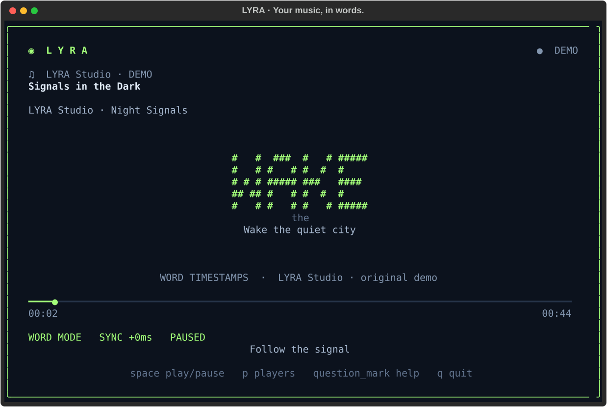

<div align="center">

# ◉ L Y R A

### Your music, in words.

A neon terminal lyrics player for Linux.<br>
Follow your music, one word at a time.


[](LICENSE)

[Get started](#get-started) · [Controls](#controls) · [Full guide](docs/GUIDE.md) · [Verification](VERIFICATION.md)



*Actual application capture · original demo lyrics · ASCII word mode*

</div>

## Music on. Terminal open.

LYRA follows the music playing on your Linux desktop and brings synchronized
lyrics into your terminal. Choose word or duo karaoke, switch to oversized ASCII
letters, or keep things minimal with compact mode.

- **Follows your player.** Discovers MPRIS players, prefers active playback, and
  lets you pin a player when several are connected.
- **Word, duo, or ASCII.** Large ASCII words support Latin and Ukrainian/Cyrillic
  letters, with readable text fallback for small terminals.
- **Timing you can understand.** Distinguishes real word timestamps, estimated
  word timing, line timing, and unsynchronized lyrics.
- **Choose your color.** White by default, plus violet, green, cyan, and amber;
  choose in display settings with **S** or cycle with **T**. Custom accents,
  small lyric context, and compact view are supported.
- **Online or local lyrics.** Looks up lyrics through LRCLIB, caches successful
  results, and accepts your own UTF-8 LRC files.
- **Try it immediately.** The built-in demo runs without a music player, network
  requests, or a D-Bus connection.

No account, microphone, or audio capture is needed. Live playback requires a
player exposing MPRIS metadata and position in your desktop session.

## Get started

**Requires Linux and Python 3.12+.** From a downloaded or cloned checkout:

```bash
cd lyra
pipx install .
pipx ensurepath
lyra --demo
```

On Arch Linux, install the prerequisites with `sudo pacman -Syu python python-pipx`.
If `lyra` is not found after installation, open a new terminal.

Then start music in your player and run:

```bash
lyra                  # Follow the active player
lyra --ascii          # Big ASCII words
lyra --compact        # Minimal view
lyra --player spotify # Prefer Spotify
lyra --lyrics examples/signals.lrc  # Use an original local sample
```

Spotify desktop and other MPRIS players can supply playback information.
Browser support depends on the browser and music website exposing metadata,
position, and controls. See [browser integration](docs/GUIDE.md#browser-integration)
and run `lyra --doctor` if a song is not detected.

## Controls

| Key | Action |
| :-- | :-- |
| `Space` | Pause / resume |
| `←` / `→` | Seek backward / forward 5 seconds |
| `↑` / `↓` | Adjust lyric offset by 50 ms |
| `W` / `D` | Word / duo karaoke |
| `A` | Toggle large ASCII words |
| `C` | Toggle compact view |
| `S` | Open display settings |
| `T` | Cycle color themes |
| `P` | Choose a player |
| `R` | Refresh lyrics |
| `H` / `?` | Open help |
| `Q` / `Ctrl+C` | Quit |

Preferences are saved on clean exit. See the [configuration guide](docs/GUIDE.md#configuration)
and [example config](examples/config.toml) for themes, shortcuts, cache, and timing options.

## About synchronization

Enhanced LRC and supported Lyricsfile data can carry real word timestamps.
Standard LRC only provides line starts: LYRA labels its word estimates with **≈**.
Plain lyrics remain **UNSYNCED**. A player without playback position cannot supply
synchronized karaoke.

Track title, artist, album, and duration are sent to LRCLIB for lookup. Local
lyrics and the demo can be used without lyric lookup. No third-party lyrics are
bundled. Read the [timing and sources guide](docs/GUIDE.md#timing-and-lyric-sources)
for matching rules and limitations.

## Development

```bash
python -m venv .venv
.venv/bin/python -m pip install -e '.[dev]'
.venv/bin/python scripts/verify.py
.venv/bin/python -m ruff check src tests scripts
.venv/bin/python -m ruff format --check src tests scripts
```

The current checkout passes **89 automated tests**, including parsing, timing,
player selection, mocked lyric requests, configuration, and headless UI controls.
Live Spotify/browser integration still needs desktop acceptance checks. The
preview above is captured from the application's built-in demo.

See [verification results](VERIFICATION.md) and the [full technical guide](docs/GUIDE.md).

## License

[MIT](LICENSE) · Copyright © 2026 [Es1xx](https://github.com/Es1xx).

The root MIT license covers the original code, documentation, and demo assets.
Third-party lyrics retain their respective rights and service terms.
